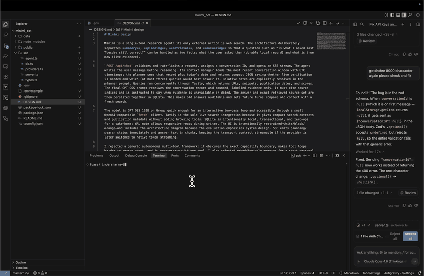

# minimi — web research agent

A single-tool research agent that remembers conversations, reasons about time, and checks the live web before answering. Built with GPT OSS 120B on Groq, Tavily search, and SQLite.

## Demo



> Auto-playing preview above (GitHub strips HTML `<video autoplay>` in READMEs, so the repository includes an optimized looping GIF alongside the full-resolution MP4: [watch / download full HD MP4](demo_video/minimi_bot_demo_inder.mp4)).

## Quick start

```bash
git clone https://github.com/inder-dev-pro/minimi_bot.git && cd minimi_bot
npm install
cp .env.example .env     # then add your API keys (see below)
npm run dev               # → http://localhost:3000
```

## Demo mode (no API keys needed)

The app ships with **sample conversations** pre-loaded in [`data/seed.sql`](data/seed.sql). On first run, these are automatically seeded into the SQLite database so you can browse real example interactions — including cited sources — without any API keys configured.

When API keys are missing, the UI shows a warning banner and lets you click through the demo conversations.

## API keys

| Key | Where to get it | Required for |
|-----|-----------------|--------------|
| `GROQ_API_KEY` | [console.groq.com](https://console.groq.com) (free) | Sending new messages (LLM) |
| `TAVILY_API_KEY` | [app.tavily.com](https://app.tavily.com) (free tier available) | Live web search |

Add them to your `.env` file. Without them the app still runs — you can browse demo conversations, and if only `GROQ_API_KEY` is set, answers run without live web search.

## Architecture

```
Chat UI (SSE streaming)
       ↕
API layer (validate, rate limit)
       ↕
┌─────────────────────────────────┐
│          AGENT CORE             │
│  Context manager → Planner →   │
│  Search tool → Answer writer   │
└─────────────────────────────────┘
       ↕            ↕           ↕
    SQLite    GPT OSS/Groq    Tavily
```

**Flow:** User message → save to DB → load conversation history → planner decides if search is needed → parallel Tavily queries → GPT OSS 120B writes a grounded, cited answer → stream back via SSE → persist answer + sources.

See [`DESIGN.md`](DESIGN.md) for full design rationale.

## Scripts

| Command | What it does |
|---------|-------------|
| `npm run dev` | Start with auto-reload (tsx watch) |
| `npm start` | Production start |
| `npm run check` | TypeScript type check |

## Sample conversations included

The seed data includes three demo conversations:

1. **Postgres hosting pricing** — Multi-turn with 5 cited sources and a follow-up asking for recommendations
2. **Earth's mass** — Simple factual question (no web search needed)
3. **Next.js releases** — Time-aware follow-up ("has anything changed since I asked?") with cited sources

## Tech stack

- **LLM**: GPT OSS 120B (`openai/gpt-oss-120b`) via Groq (OpenAI-compatible API)
- **Search**: Tavily (advanced search with publication dates)
- **Database**: SQLite with WAL mode (better-sqlite3)
- **Server**: Express + SSE streaming
- **Frontend**: Vanilla JS + Marked.js, no build step
